```mermaid
flowchart TD
    subgraph Alur1["Alur 1: Eksplorasi Kondisi Wilayah"]
        A1(["Mulai"]) --> B1["Buka situs web Luma"]
        B1 --> C1["Lihat dashboard default DKI Jakarta"]
        C1 --> D1["Pilih wilayah administratif Kota/Kabupaten"]
        D1 --> E1{"Data tingkat kecamatan tersedia?"}
        E1 -- "Ya" --> F1["Pilih kecamatan (opsional)"]
        E1 -- "Tidak, tetap tingkat kota" --> G1["Lihat indikator dan insight wilayah"]
        F1 --> G1
        G1 --> H1["Jelajahi kategori: Air, Udara, Faskes, RTH, Sekolah, Transum"]
        H1 --> I1["Tinjau nilai indikator, satuan, dan periode data"]
        I1 --> J1["Akses informasi sumber data resmi"]
        J1 --> K1{"Jelajahi kategori lain?"}
        K1 -- "Ya" --> H1
        K1 -- "Tidak" --> L1(["Selesai"])
    end

    subgraph Alur2["Alur 2: Eksplorasi Fasilitas Publik"]
        A2(["Mulai"]) --> B2["Buka peta interaktif"]
        B2 --> C2["Pilih / filter kategori fasilitas"]
        C2 --> D2["Jelajahi marker fasilitas & cluster berbentuk lingkaran"]
        D2 --> E2["Perbesar (zoom) area tertentu"]
        E2 --> F2["Pilih marker fasilitas individual"]
        F2 --> G2["Lihat detail fasilitas & informasi transparansi data"]
        G2 --> H2{"Jelajahi fasilitas lain?"}
        H2 -- "Ya" --> C2
        H2 -- "Tidak" --> I2(["Selesai"])
    end
```

# Luma — Dashboard Keterbukaan Fasilitas & Infrastruktur Publik DKI Jakarta

> **Deskripsi Singkat:**  
> Luma (*Local Urban Mapping and Analytics*) adalah platform dashboard peta interaktif berbasis data terbuka resmi DKI Jakarta untuk memantau sebaran fasilitas publik (Pendidikan, Kesehatan, RTH), infrastruktur kota (Transportasi BRT & Jaringan Pipa Air Bersih PAM JAYA), serta kualitas udara (ISPU/AQI) secara real-time, transparan, dan akuntabel.

---

## 🛠️ Tech Stack yang Digunakan

Platform Luma dikembangkan menggunakan arsitektur **Monorepo** (*npm workspaces*) dengan pemisahan aplikasi frontend dan backend:

### Frontend (`apps/web`)
- **Framework & Bahasa:** React 19, TypeScript
- **Build Tool:** Vite 6
- **Styling:** Tailwind CSS v4, Modern Glassmorphism (`.luma-glass`), Theme Tokens
- **Peta & Geospasial (GIS):** MapLibre GL (Vector & Raster Canvas, GeoJSON)
- **Visualisasi Data:** ApexCharts & React-ApexCharts
- **Linter & Code Quality:** ESLint 10, TypeScript-ESLint

### Backend API (`apps/api`)
- **Runtime & Framework:** Node.js, Express.js, TypeScript
- **Database & ORM:** PostgreSQL (`pg`), Drizzle ORM, Drizzle Kit
- **Tooling:** `tsx` (TypeScript Execution Engine)
- **Keamanan & Middleware:** Helmet, CORS, Express-Rate-Limit, Compression

---

## 🚀 Cara Menjalankan Project (Clone => Install => Run)

Ikuti langkah-langkah berikut untuk mengunduh, memasang dependensi, dan menjalankan project di lingkungan lokal:

### 1. Clone Repository
```bash
git clone https://github.com/ltnzz/luma.git
cd Luma
```

### 2. Install Dependencies
Jalankan instalasi dependensi dari direktori utama (*root*) project:
```bash
npm install
```

### 3. Run Project (Menjalankan Aplikasi)

#### Menjalankan Frontend (Web Dashboard)
```bash
npm --prefix apps/web run dev
```
Aplikasi web berjalan pada: `http://localhost:5173`

#### Menjalankan Backend API (Opsional)
```bash
npm --prefix apps/api run dev
```
Server API backend berjalan pada: `http://localhost:3000`

#### Membangun Project untuk Produksi (*Production Build*)
```bash
npm --prefix apps/web run build
```

#### Menjalankan Linting
```bash
npm --prefix apps/web run lint
```

---

## 📌 Progress Saat Ini

Berikut adalah status pencapaian fitur yang telah berhasil diimplementasikan:

1. **Dashboard Peta Interaktif Dua Layer (*Hierarchical GIS Canvas*)**:
   - **Layer 1 (Makro Provinsi):** Visualisasi sebaran agregat fasilitas per kota administrasi DKI Jakarta (5 Kota Administrasi + Kab. Kepulauan Seribu) terintegrasi skor kualitas udara real-time SPKU.
   - **Layer 2 (Mikro Wilayah):** Peta sebaran titik fasilitas publik dengan algoritma *proximity clustering* anti-tabrakan pin (*zero collision*) dan kartu pratinjau instan (*quick preview tooltip*).

2. **Integrasi Fasilitas Layanan Publik Resmi**:
   - **Fasilitas Kesehatan (Faskes Primer):** 51 RSUD dan Puskesmas Kecamatan terakreditasi resmi Dinas Kesehatan DKI Jakarta.
   - **Ruang Terbuka Hijau (RTH):** 418 Taman dan Hutan Kota dengan klasifikasi sub-kategori.
   - **Sekolah Negeri Terakreditasi:** 1.503 Satuan Pendidikan Negeri (SD, SMP, SMA, SMK, SLB) terintegrasi data Dapodik Kemendikbudristek.

3. **Infrastruktur & Jaringan Layanan Kota**:
   - **Jaringan BRT Transjakarta:** Visualisasi 13 koridor utama Transjakarta, deduplikasi halte transit/interchange, serta panel penelusuran rute dan halte.
   - **Jaringan Pipa Air Bersih PAM JAYA:** Visualisasi jalur pipa distribusi air minum perpipaan, stasiun Instalasi Pengolahan Air (IPA), dan metrik keterlayanan 68% warga.

4. **Monitoring Kualitas Udara (ISPU/AQI) Real-Time**:
   - Skala kesehatan udara 6 tingkatan (Baik, Sedang, Sensitif, Tidak Sehat, Sangat Tidak Sehat, Berbahaya) terkoneksi sensor SPKU DLH Jakarta.
   - Meteran visual tersegmentasi (*segmented gauge meter*), badge level kesehatan, dan panduan masker/ventilasi bagi warga.

5. **Side Glass Modal & Transparansi Anggaran**:
   - Panel detail fasilitas ramping di sebelah kanan dengan efek frosted glassmorphism modern tanpa menutupi kontrol peta atau dock bawah.
   - Menampilkan transparansi anggaran pembangunan/operasional (APBD/BOS/BOP), legalitas izin (PBG, SLF, SPPL), skor walkability, dan koordinat GPS presisi.

6. **Transparansi & Provenansi Sumber Data**:
   - Halaman katalog sumber data terverifikasi (Satu Data Jakarta, Kemendikbud, DLH DKI, PAM JAYA, Dinkes, Distamhut).
   - Metodologi pipeline data terbuka dan log pembaruan berkala.

---

## 🗺️ Flow Aplikasi (User Journey)

```text
User buka web Luma -> Dashboard Peta DKI -> Pilih Wilayah Kota/Kabupaten -> Tinjau Indikator (ISPU Udara, Air, Faskes, RTH, Pendidikan, Transum) -> Filter Kategori Fasilitas -> Eksplorasi Marker/Cluster Peta -> Buka Detail Fasilitas (Anggaran APBD, Legalitas Izin, Mutu Lingkungan) -> Akses Katalog Sumber Data Resmi.
```



---

## 🏛️ Arsitektur Informasi & Fitur

```
Luma
├── Dashboard Utama
│   ├── Indikator dan Insight Wilayah (Kualitas Air, Udara, Pendidikan, Kesehatan, RTH, Transum)
│   ├── Peta Interaktif (Batas Wilayah Administratif, Marker Fasilitas, Proximity Clustering, Kontrol Peta)
│   ├── Pemilihan Wilayah (Kota/Kabupaten Administratif & Informasi Tingkat Kecamatan)
│   └── Detail Fasilitas (Side Glass Modal: Nama, Kategori, Alamat/GPS, Realisasi Anggaran, Izin PBG/SLF)
└── Transparansi Sumber Data
    ├── Sumber Dataset Resmi (Satu Data Jakarta, Kemendikbud, DLH, PAM JAYA, Dinkes, Distamhut)
    ├── Periode Pembaruan Data & Metodologi Pipeline
    └── Keterbatasan Data & Catatan Akurasi
```
