```mermaid
flowchart TD
    subgraph Alur1["Alur 1: Eksplorasi Kondisi Wilayah"]
        A1(["Mulai"]) --> B1["Buka situs web Luma"]
        B1 --> C1["Dashboard DKI Jakarta tampil"]
        C1 --> D1["Pilih wilayah Kota/Kabupaten"]
        D1 --> E1["Pilih indikator kategori data"]
        E1 --> F1["Tinjau nilai: satuan, periode, cakupan, status ketersediaan"]
        F1 --> G1["Periksa sumber: metode pengolahan & keterbatasan"]
        G1 --> H1{"Pilih kategori lain?"}
        H1 -- "Ya (tanpa pilih wilayah ulang)" --> E1
        H1 -- "Tidak" --> I1(["Selesai"])
    end

    subgraph Alur2["Alur 2: Eksplorasi Fasilitas Publik"]
        A2(["Mulai"]) --> B2["Buka peta interaktif"]
        B2 --> C2["Pilih kategori fasilitas (Filter)"]
        C2 --> D2["Jelajahi peta (Zoom & buka klaster)"]
        D2 --> E2["Pilih marker fasilitas individual"]
        E2 --> F2["Lihat detail: nama, lokasi, kategori, sumber & periode"]
        F2 --> G2{"Eksplorasi fasilitas lain?"}
        G2 -- "Ya (ubah filter / pilih marker lain)" --> C2
        G2 -- "Tidak" --> H2(["Selesai"])
    end
```

# Luma — Local Urban Mapping & Analytics (DKI Jakarta)

> **Deskripsi Singkat:**  
> Luma (*Local Urban Mapping & Analytics*) adalah platform berbasis web untuk mengeksplorasi kondisi wilayah dan persebaran fasilitas publik di DKI Jakarta. Luma mengintegrasikan data terbuka dari enam sektor, mengolahnya berdasarkan wilayah administratif, lalu menyajikannya melalui peta interaktif, bilah indikator wilayah, dan katalog transparansi data.

---

## 🛠️ Tech Stack yang Digunakan

Platform Luma dikembangkan menggunakan arsitektur **Monorepo** (*npm workspaces*) dengan pemisahan aplikasi frontend dan backend:

### Frontend (`apps/web`)
- **Framework & Bahasa:** React 19, TypeScript
- **Build Tool:** Vite 6
- **Styling:** Tailwind CSS v4, Modern Glassmorphism (`.luma-glass`), Theme Tokens
- **Peta & Geospasial (GIS):** MapLibre GL (Vector & Raster Canvas, GeoJSON)
- **Visualisasi Data:** ApexCharts & React-ApexCharts
- **Internasionalisasi (i18n):** Multi-bahasa (Bahasa Indonesia & English)
- **Pengujian:** Vitest, React Testing Library

### Backend API (`apps/api`)
- **Runtime & Framework:** Node.js, Express.js, TypeScript
- **Database & ORM:** PostgreSQL (`pg`), Drizzle ORM, Drizzle Kit
- **Tooling:** `tsx` (TypeScript Execution Engine)
- **Keamanan & Middleware:** Helmet, CORS, Express-Rate-Limit, Compression

---

## 🚀 Cara Menjalankan Project (Clone => Install => Run)

Ikuti langkah-langkah berikut untuk mengunduh, memasang dependensi, dan menjalankan project di lingkungan lokal:

### 1. Clone Repository
```bash
git clone https://github.com/ltnzz/luma.git
cd Luma
```

### 2. Install Dependencies
Jalankan instalasi dependensi dari direktori utama (*root*) project:
```bash
npm install
```

### 3. Run Project (Menjalankan Aplikasi)

#### Menjalankan Frontend (Web Dashboard)
```bash
npm --prefix apps/web run dev
```
Aplikasi web berjalan pada: `http://localhost:5173`

#### Menjalankan Backend API (Opsional)
```bash
npm --prefix apps/api run dev
```
Server API backend berjalan pada: `http://localhost:3000`

#### Menjalankan Pengujian Otomatis (*Unit Tests*)
```bash
npm --prefix apps/web test
```

#### Membangun Project untuk Produksi (*Production Build*)
```bash
npm --prefix apps/web run build
```

---

## 📌 Kapabilitas & Fitur Saat Ini

Berikut adalah status fitur yang telah diimplementasikan secara riil pada platform Luma:

1. **Dashboard Peta Interaktif Spasial (*Hierarchical GIS Canvas*)**:
   - **Tingkat Provinsi:** Marker agregat se-DKI Jakarta dengan ringkasan jumlah fasilitas dan aksesibilitas air bersih.
   - **Tingkat Kota/Kabupaten:** Navigasi 6 wilayah kota/kabupaten administrasi terintegrasi batas wilayah resmi, sampel kualitas udara US AQI per kota, dan filter solo-focus.
   - **Marker & Klaster Dinamis:** Visualisasi sebaran titik fisik dengan algoritma *proximity clustering* adaptif zoom untuk mencegah penumpukan pin marker.

2. **Integrasi Enam Sektor Fasilitas & Infrastruktur Terbuka**:
   - **Fasilitas Kesehatan:** 51 RSUD dan Puskesmas Kecamatan berbasis data terbuka Dinas Kesehatan Provinsi DKI Jakarta.
   - **Ruang Terbuka Hijau (RTH):** Sebaran Taman Kota, Hutan Kota, dan Jalur Hijau berbasis data Dinas Pertamanan dan Hutan Kota DKI Jakarta.
   - **Pendidikan Negeri:** 1.503 Satuan Pendidikan Negeri (SD, SMP, dan SMA) terintegrasi Dapodik Kemendikbudristek & Disdik DKI Jakarta.
   - **Transportasi Publik BRT:** 13 koridor utama rute Bus Rapid Transit (BRT) Transjakarta serta ratusan titik halte terintegrasi.
   - **Jaringan Air Bersih:** Digitasi kurasi koridor pipa transmisi utama PAM JAYA dan instalasi pengolahan air bersih (keterlayanan ~68%).
   - **Kualitas Udara:** Integrasi berkala model kimia atmosfer Open-Meteo Air Quality API (US AQI, PM2.5, PM10) dengan cache 15 menit.

3. **Integritas Status Informasi Transparan**:
   - Membedakan penandaan data secara eksplisit antara **Data Resmi Pemerintah**, **Data Hasil Kurasi**, dan **Estimasi Berbasis Model Atmosfer** agar pengguna dapat menilai konteks informasi secara tepat.

4. **Modal Detail Fasilitas Samping (*Side Glass Panel*)**:
   - Panel informasi fasilitas ramping (*desktop side-glass & mobile bottom-sheet*) menyajikan nama fasilitas, alamat/wilayah, kategori, indikator kualitas udara acuan sekitar, serta status ketersediaan metadata.

5. **Orientasi Pengguna & Aksesibilitas**:
   - Tur pengenalan mandiri (*onboarding tutorial*) 9 langkah dengan efek *spotlight overlay*.
   - Dukungan dwi-bahasa (Bahasa Indonesia & English).
   - Pengalih tema tampilan (Mode Terang & Mode Gelap).

6. **Katalog Transparansi Sumber Data**:
   - Dokumentasi lengkap setiap sektor data: instansi penerbit, tautan sumber asli, cakupan wilayah, satuan pengukuran, metodologi normalisasi, dan periode pemutakhiran.

---

## 🗺️ Alur Pengguna (User Flow)

```text
User buka web Luma -> Dashboard Peta DKI -> Pilih Wilayah Kota/Kabupaten -> Tinjau Indikator Wilayah (Kualitas Udara US AQI, Jaringan Air, Faskes, RTH, Sekolah, Transportasi) -> Filter Kategori Fasilitas -> Eksplorasi Klaster & Marker Peta -> Buka Detail Fasilitas (Nama, Lokasi, Kategori, Kondisi Wilayah, & Metadata) -> Akses Katalog Transparansi Data Resmi.
```



---

## 🏛️ Arsitektur Informasi

```
Luma
├── 1. Dashboard Utama
│   ├── Pemilihan Wilayah (Provinsi DKI Jakarta & 6 Kota/Kabupaten Administrasi)
│   ├── Peta Interaktif (Batas Wilayah, Marker Fasilitas, Klaster Dinamis, Koridor BRT & Pipa Air)
│   ├── Bilah Indikator Wilayah (Kualitas Udara, Jaringan Air, Faskes, RTH, Sekolah, Transportasi)
│   └── Detail Fasilitas (Modal Kaca: Identitas, Lokasi Presisi, Kondisi Lingkungan Acuan, Status Metadata)
├── 2. Transparansi Data
│   ├── Katalog Dataset Resmi (Open-Meteo, Satu Data Jakarta, Dinkes, Distamhut, Dapodik, PAM JAYA, Transjakarta)
│   ├── Cakupan & Periode Data (Status Ketersediaan, Satuan, Waktu Snapshot)
│   ├── Metode Pengolahan (Normalisasi, Kurasi, Agregasi Spasial)
│   └── Keterbatasan Data (Kelengkapan Metadata, Lisensi Terbuka)
└── 3. Bantuan & Preferensi
    ├── Tur Pengenalan (Panduan Fitur 9 Langkah Interaktif)
    ├── Pengaturan Bahasa (Bahasa Indonesia & English)
    └── Tema Tampilan (Mode Terang & Mode Gelap)
```

---

## 📚 Sumber Data & Daftar Pustaka

| Sektor | Sumber / Instansi Penyedia | Tautan Resmi | Status Data |
|:---|:---|:---|:---|
| **Kualitas Udara** | Open-Meteo Air Quality API | [open-meteo.com](https://open-meteo.com/en/docs/air-quality-api) | Berbasis Model Atmosfer |
| **Fasilitas Kesehatan** | Dinas Kesehatan DKI Jakarta (Satu Data Indonesia) | [data.go.id](https://data.go.id/dataset/data-keberadaan-sarana-kesehatan-di-provinsi-dki-jakarta) | Snapshot Resmi Terkurasi |
| **Ruang Terbuka Hijau** | Distamhut Provinsi DKI Jakarta (Satu Data Jakarta) | [satudata.jakarta.go.id](https://satudata.jakarta.go.id/) | Snapshot Resmi Terkurasi |
| **Sekolah Negeri** | Dapodik Kemendikbudristek & Dinas Pendidikan DKI | [dapo.kemdikbud.go.id](https://dapo.kemdikbud.go.id/) | Data Pokok Pendidikan |
| **Transportasi Umum** | PT Transportasi Jakarta (Transjakarta) | [transjakarta.co.id](https://transjakarta.co.id/) | Operasional BRT |
| **Jaringan Air Bersih** | PAM JAYA / Perum Jasa Tirta II | [pamjaya.co.id](https://www.pamjaya.co.id/) | Digitasi Koridor Terkurasi |
| **Batas Administrasi** | GADM (Database of Global Administrative Areas) | [gadm.org](https://gadm.org/) | Data Spasial Level 2 |
| **Peta Dasar (*Tiles*)** | Esri / ArcGIS Online Basemap Services | [server.arcgisonline.com](https://server.arcgisonline.com/) | Layanan Peta Ubin |

---

## 📄 Lisensi

Proyek ini dikembangkan untuk tujuan inovasi keterbukaan data publik DKI Jakarta.
